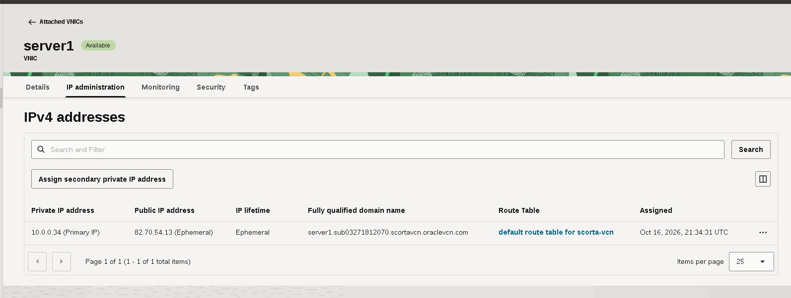
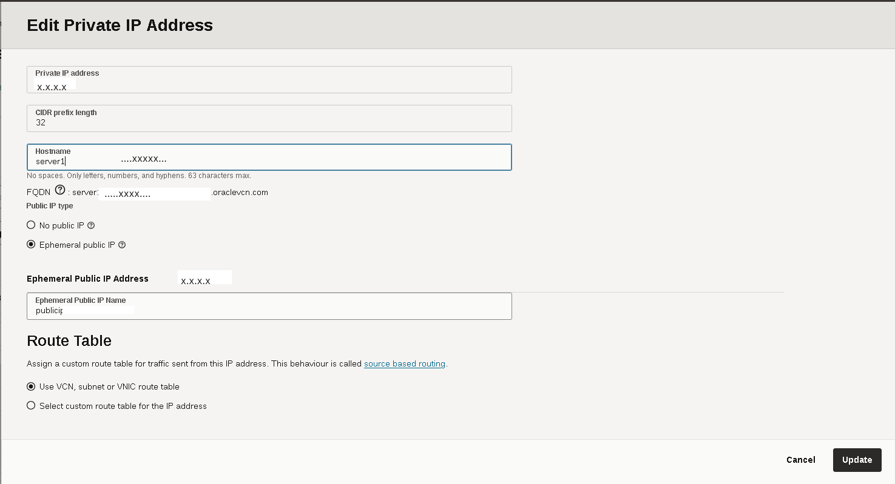

# How to Change Public IP Address on Oracle Cloud VPS

This guide explains how to change the public IP address of an Oracle Cloud Infrastructure (OCI) instance by removing the current IP address and requesting a new Ephemeral public IP.

---

## Step 1: Open IP Administration

1. Go to your Instance details in the **Oracle Cloud Console**.
2. Under **Resources**, click on **Attached VNICs** and select your primary VNIC.
3. Open the **IP administration** tab to see your assigned Private and Public IP addresses.
4. Locate your current IP address and click the three action dots (`...`) on the right side of the row.

---

## Step 2: Remove the Current Public IP

1. In the menu that opens, select **Edit**.
2. Under **Public IP type**, select **No public IP**.
3. Click **Update** at the bottom right.

This step detaches and releases your current public IP address back to Oracle's IP pool.

---

## Step 3: Assign a New Ephemeral Public IP

1. Once updated, click the three action dots (`...`) next to your private IP address again.
2. Select **Edit**.
3. Under **Public IP type**, select **Ephemeral public IP**.
4. Click **Update**.

Oracle Cloud will automatically assign a new random public IP address to your instance.